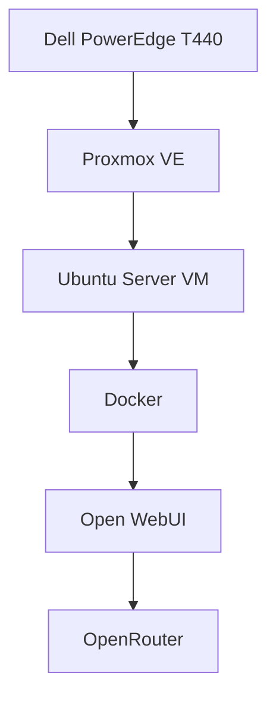

# Enterprise Home Lab

A self-hosted enterprise IT lab designed, deployed, and maintained by Jonathan Rittenour. This project documents hands-on work with virtualization, Linux administration, containerization, secure remote access, AI integration, and infrastructure automation.

## Project Objectives

- Build and manage an enterprise-style virtualized environment.
- Deploy and secure Linux servers and containerized applications.
- Explore self-hosted AI and business automation solutions.
- Practice infrastructure monitoring, troubleshooting, and capacity planning.
- Document architecture, configuration decisions, and lessons learned.

## Infrastructure Overview

| Component | Technology |
| --- | --- |
| Physical server | Dell PowerEdge T440 |
| Hypervisor | Proxmox VE |
| Virtualization | Linux virtual machines |
| Operating system | Ubuntu Server 24.04 LTS |
| Containers | Docker |
| Secure remote access | Tailscale and SSH |
| AI interface | Open WebUI |
| AI model access | OpenRouter |

## Current Projects

### Self-Hosted AI Assistant

Deployed Open WebUI in a Docker container on an Ubuntu virtual machine, connected to OpenRouter for AI model access. Configured a custom business assistant with dedicated instructions, a supplier knowledge base, and web research capabilities.

**Technical areas:** Docker administration, Linux, API integration, AI configuration, knowledge management, and troubleshooting.

### Virtualized Server Infrastructure

Configured a Dell PowerEdge T440 as a Proxmox virtualization host. Deployed an Ubuntu Server virtual machine to support containerized services and future automation projects.

**Technical areas:** Server administration, virtualization, resource allocation, remote access, and infrastructure planning.

## Roadmap

- [x] Deploy Proxmox VE virtualization host
- [x] Deploy Ubuntu Server virtual machine
- [x] Install Docker and Open WebUI
- [x] Configure OpenRouter AI integration
- [x] Configure secure remote access using Tailscale
- [ ] Document infrastructure architecture
- [ ] Implement and document backup and recovery procedures
- [ ] Deploy additional purpose-built virtual machines
- [ ] Introduce monitoring and infrastructure automation
- [ ] Evaluate local AI inference options

## Security and Documentation

Public documentation excludes credentials, API keys, private network addresses, customer information, and confidential business records. Configuration examples will use placeholders where appropriate.

## About

**Jonathan Rittenour**

IT infrastructure and operations professional developing practical experience in enterprise virtualization, Linux systems, AI integration, and automation through self-directed projects.

This repository is an evolving technical portfolio. Additional documentation and implementation details will be added as the environment develops.

## Infrastructure Architecture

The following diagram illustrates the current home lab architecture, including the virtualization host, Ubuntu VM, containerized AI application, and external AI provider.

### Architecture Notes

- **Physical infrastructure:** Dell PowerEdge T440 running Proxmox VE.
- **Virtualization:** Ubuntu Server VM hosts containerized applications.
- **Application hosting:** Docker runs Open WebUI.
- **AI integration:** Open WebUI connects to OpenRouter for AI model access.
- **Remote administration:** Tailscale and SSH provide secure remote access.
- **Future expansion:** Additional VMs will be documented as they are deployed.

